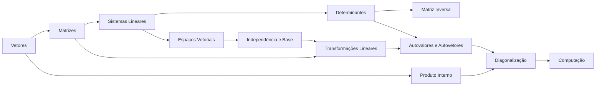

# Álgebra Linear — Índice

## A ideia central
Álgebra Linear estuda **vetores** e as **transformações lineares** entre eles. Matrizes são só a *representação* (a "planilha") dessas transformações. Quase tudo na computação que mexe com dados em volume — gráficos 3D, machine learning, busca, compressão — é, no fundo, álgebra linear.

> Cálculo estuda como as coisas **mudam** (curvas); Álgebra Linear estuda o que acontece quando tudo é **reto** (retas, planos, espaços). E os dois se encontram: a derivada de uma função de várias variáveis é uma transformação linear (ver [[Gradiente e Derivada Direcional]]).

## Ordem de estudo
1. [[Vetores no Espaço Euclidiano]]
2. [[Matrizes]]
3. [[Sistemas Lineares]]
4. [[Determinantes]]
5. [[Matriz Inversa]]
6. [[Espaços Vetoriais]]
7. [[Independência Linear e Base]]
8. [[Transformações Lineares]]
9. [[Autovalores e Autovetores]]
10. [[Diagonalização]]
11. [[Produto Interno e Ortogonalidade]]
12. [[Álgebra Linear na Computação]]

Prática: [[Exercícios de Álgebra Linear]] · Consulta rápida: [[Álgebra Linear - tabela]]

## Mapa de dependências

## Pré-requisitos (o que já está no vault)
- [[Álgebra - Índice]] (em especial [[Equações do 1º Grau e Sistemas]], [[Produtos Notáveis e Fatoração]] e [[Polinômios - Divisão e Raízes]]), além de [[Álgebra básica]] e [[Equações e inequações]] — manipulação algébrica e sistemas pequenos
- [[Vetores - introdução]] e [[Geometria analítica]]
- [[Trigonometria]] — rotações

## Como estudar
Siga o método de [[Como estudar]]. Em Álgebra Linear, uma regra extra ajuda muito: **para cada conceito, pergunte "o que isso significa geometricamente?"** e depois **"como o computador calcularia isso?"**. As duas respostas juntas é que fixam o assunto.
