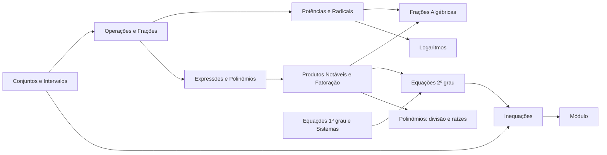

# Álgebra — Índice

## A ideia central
Álgebra é a linguagem que usa **letras no lugar de números** para falar de qualquer número ao mesmo tempo. Em vez de "$3+4=4+3$", escreve-se "$a+b=b+a$" e pronto: vale sempre. Quase todo erro em Cálculo não vem do cálculo em si, mas de **manipulação algébrica** malfeita — por isso esta é a base mais importante do vault.

> Aqui está a **álgebra elementar** (a "normal"). A [[Álgebra Linear - Índice|Álgebra Linear]] vem depois e usa tudo o que está aqui.

## Ordem de estudo
1. [[Conjuntos Numéricos e Intervalos]]
2. [[Operações, Frações e Propriedades]]
3. [[Potenciação e radiciação]]
4. [[Expressões Algébricas e Polinômios]]
5. [[Produtos Notáveis e Fatoração]]
6. [[Frações Algébricas e Racionalização]]
7. [[Equações do 1º Grau e Sistemas]]
8. [[Equações do 2º Grau]]
9. [[Inequações e Estudo de Sinal]]
10. [[Módulo e Equações Modulares]]
11. [[Polinômios - Divisão e Raízes]]
12. [[Logaritmos]] (inclui equações exponenciais e logarítmicas)

Prática: [[Exercícios de Álgebra]] · Consulta rápida: [[Álgebra - tabela]]

## Mapa de dependências

## Onde isso aparece depois
- [[Cálculo I/Limites]]: fatorar e racionalizar resolve a maioria das indeterminações $0/0$.
- [[Funções - visão geral]] e [[Funções polinomiais]]: domínio, raízes e sinal.
- [[Cálculo I/Derivada]]: simplificar a expressão depois de derivar.
- [[Álgebra Linear - Índice]]: sistemas, polinômio característico, determinantes.
- Computação: complexidade de algoritmos ($\log n$, $n^2$), aritmética modular, bases numéricas.

## Como estudar
Siga o método de [[Como estudar]]. Dica específica para álgebra: **sempre confira o resultado substituindo de volta** na equação original — é grátis e pega quase todo erro de sinal.
